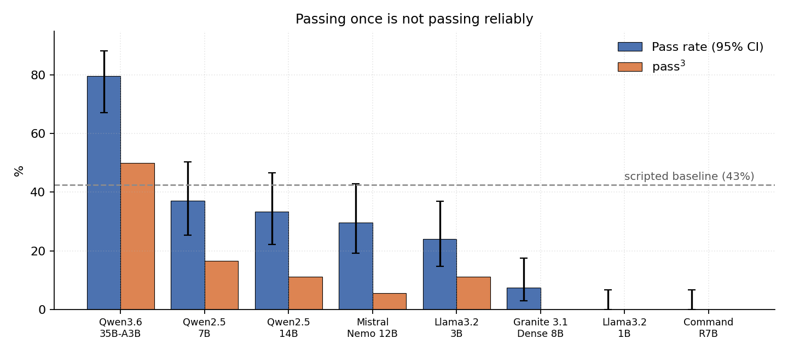
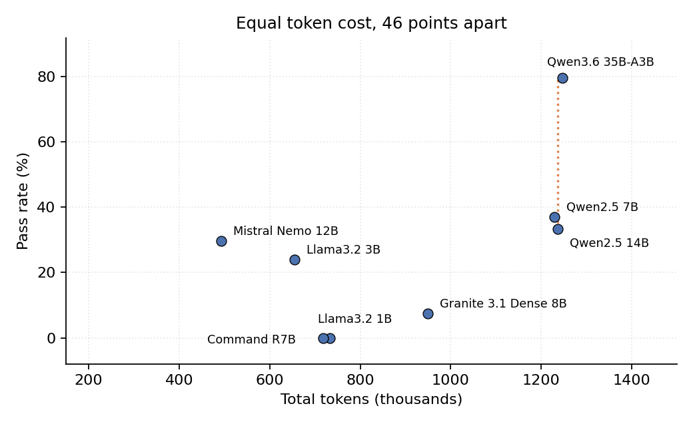

<div align="center">

# OpsBench

**A reliability-oriented benchmark for open-weight agents on internal enterprise operations**

*Accepted at the NeurIPS 2026 Workshop on Agentic AI Benchmarks and Applications for Enterprise Tasks*

[Overview](#overview) · [Key results](#key-results) · [Quickstart](#quickstart) · [Repository layout](#repository-layout) · [Citation](#citation)

</div>

---

## Overview

OpsBench brings [τ-bench](https://arxiv.org/abs/2406.12045)'s dialogue-driven, repeated-trial
evaluation to **internal enterprise operations**, starting with an IT helpdesk. An LLM agent
resolves employee requests against a mock environment while a separate LLM plays the employee.
Scoring is deterministic: each scenario declares the expected final environment state (ticket
status, verification flags, approval flags), and no LLM judges the transcript.

- **18 scenarios, 6 policy dimensions:** KB-resolvable issues, identity verification
  (including adversarial wrong-code and pressure cases), hardware requests around the $500
  approval threshold, escalation judgment, out-of-scope and edge cases, and priority assignment.
- **pass^k reliability:** every scenario runs k=3 times. pass^3 counts scenarios passed in all
  three runs, so it exposes models that succeed once but cannot repeat it.
- **Runs entirely locally:** eight open-weight models through [Ollama](https://ollama.com),
  on a single laptop, at zero monetary cost.

## Key results

Eight open-weight agents, 18 scenarios, k=3 (432 dialogues). Llama 3.1 8B plays the employee
in every run.

| Model | Pass rate | pass^3 |
|---|---:|---:|
| Qwen3.6 35B-A3B | 80% | 50% |
| *Scripted baseline (no LLM)* | *43%* | *39%* |
| Qwen 2.5 7B | 37% | 17% |
| Qwen 2.5 14B | 33% | 11% |
| Mistral Nemo 12B | 30% | 6% |
| Llama 3.2 3B | 24% | 11% |
| Granite 3.1 Dense 8B | 7% | 0% |
| Llama 3.2 1B | 0% | 0% |
| Command-R7B | 0% | 0% |

<p align="center">
  
</p>

- **Reliability under repetition is the bottleneck.** Even the best model passes 80% of
  single runs but only 50% of scenarios in all three runs.

<p align="center">
  
</p>

- **Equal token cost can hide large accuracy gaps.** Qwen 2.5 14B and Qwen3.6-35B-A3B use
  almost identical tokens yet differ by 46 points of pass rate.
- **A tool-calling format mismatch can hide a capability gap.** Granite writes its tool calls
  as plain text that its Ollama template never parses. With the calls parsed it still reaches
  only 7%, so most of its failure comes from the model itself.

Pass rate by policy dimension, pooled over all eight models:

| Policy dimension | Scenarios | Pass rate |
|---|---:|---:|
| Identity verification | 4 | 38.5% |
| Escalation judgment | 3 | 27.8% |
| KB-resolvable issues | 3 | 26.4% |
| Hardware requests | 5 | 24.2% |
| Priority assignment | 1 | 16.7% |
| Out-of-scope / edge cases | 2 | 10.4% |

See the paper for caveats: 18 LLM-authored scenarios, one vertical, one user-simulator, and
state-based scoring that cannot detect prose-only fabrication.

## Quickstart

Requires Python 3.10+ and [Ollama](https://ollama.com).

```bash
pip install -r requirements.txt

# pull the eight agent models and the user-simulator
for m in qwen3.6:35b qwen2.5:14b qwen2.5:7b mistral-nemo:12b llama3.2:3b llama3.2:1b \
         command-r7b granite3.1-dense:8b llama3.1:8b; do
  ollama pull "$m"
done

cd src
python evaluate.py --k 3 --out raw_results_full18_k3.json \
  --models qwen3.6:35b qwen2.5:14b qwen2.5:7b mistral-nemo:12b llama3.2:3b llama3.2:1b \
           command-r7b granite3.1-dense:8b
python run_baseline.py --k 3 --out baseline_results.json   # scripted, non-LLM baseline
python paper_stats.py                                      # recomputes every number in the paper
python make_figures.py                                     # regenerates the figures in docs/
```

The full run is long (several hours on a laptop), so `--resume` skips runs already saved in
`--out`. Other options: `--scenarios <ids...>` runs a subset, and `--user-model <tag>` swaps
the user-simulator.

**Reproduce the paper's numbers without re-running anything:** the raw dialogues are in
`results/`, and `python src/paper_stats.py` recomputes the pass rates, pass^3, confidence
intervals, correlations, and the baseline, Granite, and simulator analyses from them.

## Repository layout

```
src/
  environment/        mock ticketing, employee directory, knowledge base, hardware requests
  scenarios.py        the 18 scenarios: persona + declarative expected state
  policy.py           the IT policy given to the agent (also the scoring ground truth)
  agent.py            Ollama tool-calling agent under test
  user_simulator.py   LLM-played employee
  evaluate.py         runs dialogues and scores them against each scenario's expected state
  baseline_agent.py   fixed, non-LLM reference policy
  run_baseline.py     runs the baseline through the same harness
  paper_stats.py      reproduces the paper's statistics from results/
  make_figures.py     regenerates the figures in docs/
docs/                 README figures
results/
  raw_results_full18_k3.json               all 432 agent dialogues
  baseline_results.json                    scripted baseline, 54 dialogues
  granite_without_text_call_parsing.json   Granite with Ollama-native parsing only (0/54)
  altsim_check.json                        Phi-4 14B as user-simulator, 30 dialogues
```

## Adding a scenario

A scenario in `src/scenarios.py` is a seeded set of employees, a persona for the simulated
employee, and an `expected` dict. `score_scenario()` in `src/evaluate.py` checks whichever
keys are present against the final environment state (for example `final_ticket_status`,
`expected_escalation`, `password_actually_reset`, `hardware_item_expected`), so a new
scenario needs no grading code.

## Citation

If you use OpsBench, please cite the workshop paper:

```bibtex
@inproceedings{hendria2026opsbench,
  title     = {OpsBench: A Reliability-Oriented Benchmark for Open-Weight Agents on Internal Enterprise Operations},
  author    = {Hendria, Willy Fitra},
  booktitle = {NeurIPS 2026 Workshop on Agentic AI Benchmarks and Applications for Enterprise Tasks},
  year      = {2026}
}
```

## License

MIT, see [LICENSE](LICENSE).

---

<div align="center">

Built by [Hidden State Research](https://hiddenstateresearch.com)

</div>
